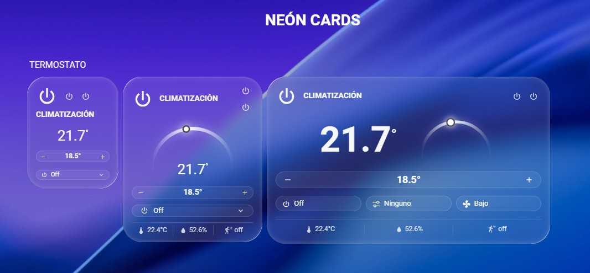
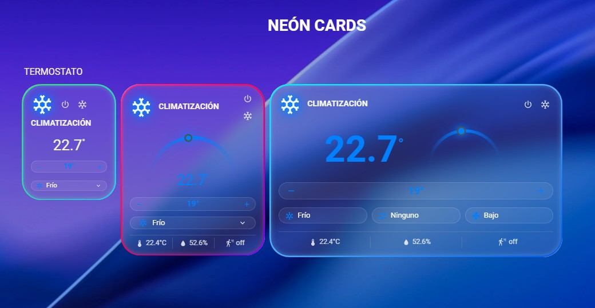
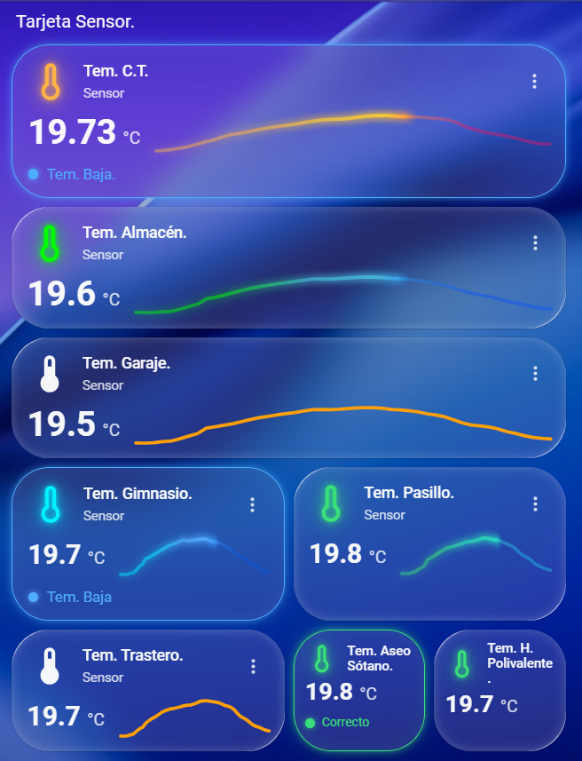
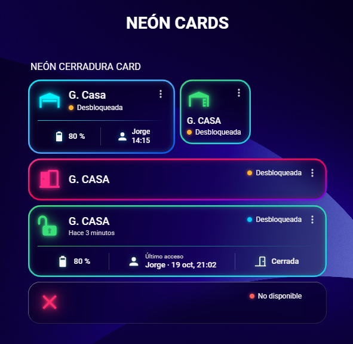
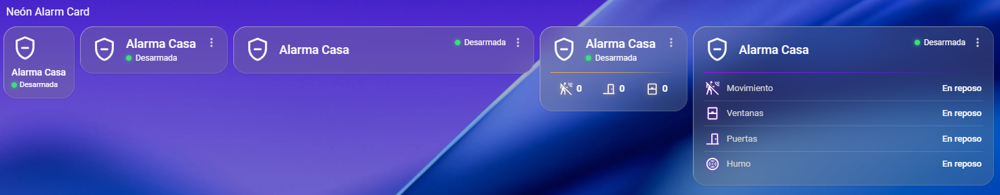
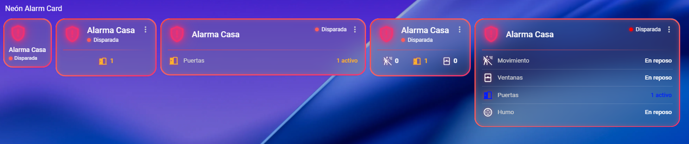
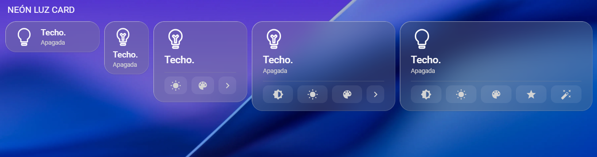

# examples/

🇪🇸 Español (esta sección) · 🇬🇧 [English below](#examples-english)

Ejemplos oficiales de uso de cada tarjeta y de cada API pública (acuerdo
nº12 y nº17).

## Neón Entity Card (`custom:neon-card-entity`)

### YAML mínimo

```yaml
type: custom:neon-card-entity
entity: light.living_room
```

### YAML avanzado

```yaml
type: custom:neon-card-entity
name: Salón
neon_palette: cyberpunk
entities:
  - entity: light.living_room
    name: Techo
  - entity: switch.tv_plug
    name: TV
tap_action:
  action: more-info
hold_action:
  action: toggle
double_tap_action:
  action: none
show_status_dot: false
primary_info: name
secondary_info: last-changed
card_orientation: right
```

### Capturas


### Video

https://github.com/user-attachments/assets/8ae87d5e-a995-4531-8aae-b137a4cc1fca

### Explicación

Neón Entity Card es un interruptor con un halo neón degradado de 3 colores
alrededor de la píldora. Cada entidad puede mostrar información primaria y
secundaria (nombre, estado, último cambio...), un punto de estado opcional,
y admite tap / mantener pulsado / doble toque configurables por separado.
La orientación de la tarjeta (`card_orientation`) permite elegir si la
píldora queda a la izquierda (por defecto) o a la derecha, con la
información en el lado contrario.

Ver la [referencia de API completa](../docs/es/api.md) para el detalle de
cada opción.

## Neón Button Card (`custom:neon-button-card`)

### YAML mínimo

```yaml
type: custom:neon-button-card
name: Salón
icon: mdi:sofa
```

### YAML avanzado

```yaml
type: custom:neon-button-card
entity: light.salon
subtitle: Luces
neon_palette: cyberpunk
tap_action:
  action: toggle
hold_action:
  action: more-info
double_tap_action:
  action: none
top_sensor:
  entity: sensor.salon_power
  icon: mdi:flash
  decimals: 0
sensors:
  - entity: sensor.salon_temperature
  - entity: sensor.salon_humidity
    icon: mdi:water-percent
```

### Capturas


### Video

https://github.com/user-attachments/assets/52b46ae6-df7a-4e43-ba21-e260f69b32ac

### Explicación

Neón Button Card es un botón de acción con entidad principal opcional:
puede navegar a otra pestaña, abrir un popup/more-info, ejecutar un
script/servicio, o representar una habitación/zona sin estar ligado a
ningún dominio concreto. En estado activo, un halo neón con degradado de
3 colores se dibuja en dos direcciones desde la esquina superior
izquierda, encontrándose en la inferior derecha — mismo lenguaje visual
que el halo de Neón Entity Card, pero con mecanismo propio (no comparte
componente con ella). Admite un sensor suelto (`top_sensor`) y hasta 3
sensores agrupados (`sensors`) bajo un divisor, con icono/estado/unidad
calculados automáticamente. El tamaño de la tarjeta (ancho y alto en el
grid de HA) se calcula solo según el contenido configurado.

## Neón Thermostat Card (`custom:neon-thermostat-card`)

### YAML mínimo

```yaml
type: custom:neon-thermostat-card
entity: climate.salon
```

### YAML avanzado

```yaml
type: custom:neon-thermostat-card
name: Salón
entity: climate.salon_calor
entity_2: climate.salon_frio
mode_owner:
  heat_cool: 1
size: large
color:
  mode: custom
  heat: "#ff4500"
  cool: "#0080ff"
neon_palette: cyberpunk
footer:
  - entity: sensor.salon_temperature
  - entity: sensor.salon_humidity
  - entity: binary_sensor.salon_presencia
    icon: mdi:motion-sensor
```

### Capturas




### Video

https://github.com/user-attachments/assets/c63b32f6-91c9-46d2-b6d7-fd5577900b99

### Explicación

Neón Thermostat Card controla una entidad `climate` con un dial/aro
semicircular (180°) arrastrable, coloreado según el modo HVAC activo.
A diferencia de Button, su tamaño no se calcula del contenido — se
elige con la clave `size` (`large`/`normal`/`compact`), cada uno con
su propio layout: el dial completo solo aparece en `large`,
`normal`/`compact` usan un indicador circular más pequeño, y
`compact` no muestra footer de sensores. Cada tamaño ocupa un hueco
fijo de la rejilla: `compact` 5×4, `normal` («Mediana» en el editor) 8×5
y `large` 12×5 (columnas × filas). Admite opcionalmente una
segunda entidad `climate` (`entity_2`) para representar dos equipos
separados (p. ej. calefacción + aire acondicionado) como uno solo — el
selector de modo muestra la unión de los modos de ambas entidades, y
al elegir un modo en la tarjeta, la otra se apaga si estaba en un modo
distinto (estar activas juntas en el *mismo* modo sí está permitido);
los cambios hechos fuera de la tarjeta no los toca (para esos casos, el
README del termostato incluye una automatización de ejemplo). Igual que Button,
admite un footer de sensores (dominios `sensor`/`binary_sensor`,
máximo 3).


---

## Neón Sensor Card (`custom:neon-sensor-card`)

### YAML mínimo

```yaml
type: custom:neon-sensor-card
entity: sensor.temperatura_exterior
```

### YAML avanzado

```yaml
type: custom:neon-sensor-card
entity: sensor.temperatura_exterior
name: Temperatura Exterior
subtitle: Jardín
icon: mdi:thermometer
graph_hours: 24
neon_effect: halo
neon_palette: electric
thresholds_enabled: true
threshold_low: 22
threshold_high: 26
threshold_colors:
  low: "#4facfe"
  ok: "#39e07a"
  high: "#ff3d5a"
threshold_names:
  low: "Frío"
  ok: "Confort"
  high: "Calor"
tap_action:
  action: more-info
```

Sin subtítulo:

```yaml
type: custom:neon-sensor-card
entity: sensor.temperatura_exterior
show_subtitle: false
```

Con un sensor binario:

```yaml
type: custom:neon-sensor-card
entity: binary_sensor.puerta_entrada
thresholds_enabled: true
alert_state: "on"
```

Con un solo color y tamaño grande:

```yaml
type: custom:neon-sensor-card
entity: sensor.temperatura_garaje
size: large
neon_effect: single
neon_color: "#ff9f1a"
```

### Capturas



### Video

https://github.com/user-attachments/assets/61e9c55d-5969-4e8a-8084-c566e2018f88

### Explicación

Neón Sensor Card muestra una única entidad `sensor` o `binary_sensor`
(cualquier otro dominio se rechaza): nombre, icono, valor con unidad y
estado y el histórico dibujado como el trazo de un monitor de
constantes vitales (en los tamaños `normal` y `large`; el `compact` no
lleva gráfico). `neon_effect`
elige el efecto del gráfico y del icono: `halo` (por defecto, gráfico y
resplandor en tres colores con desplazamiento), `single` (un solo color
con desplazamiento) o `normal` (color del tema, sin desplazamiento). El
perímetro de la tarjeta es independiente: lo marcan solo los umbrales,
que son opcionales. Con `thresholds_enabled`, por debajo de
`threshold_low` es Bajo, por encima de `threshold_high` es Alto y entre
ambos es Correcto, cada nivel con su color (`threshold_colors`) en el
borde y con su nombre (`threshold_names`) en la etiqueta de estado bajo
el valor. Sin umbrales no hay etiqueta y el perímetro se ve normal. El
tamaño se elige con `size`: `large` (grande, ancho máximo, con gráfico),
`normal` (mediano, con gráfico) o `compact` (pequeño, sin gráfico). Cada
tamaño ocupa un hueco fijo de la rejilla (columnas × filas): `compact` 3×2,
`normal` 6×2 y `large` 12×2. El pequeño muestra siempre un decimal
(`xx.x`). No lleva pie de sensores.

---

## Neón Lock Card (`custom:neon-lock-card`)

### YAML mínimo

```yaml
type: custom:neon-lock-card
entity: lock.puerta_principal
```

### YAML avanzado

```yaml
type: custom:neon-lock-card
entity: lock.puerta_principal
name: Puerta principal
lock_icon: door
size: large
subtitle_type: state
neon_palette: emerald
status_color_open: "#ffb02e"
footer_items:
  - door
  - battery
  - last_user
door_entity: binary_sensor.puerta_principal_abierta
battery_entity: sensor.puerta_principal_bateria
last_user_entity: sensor.puerta_principal_ultimo_acceso
confirm_open: true
tap_action:
  action: toggle
hold_action:
  action: more-info
```

Garaje con puerta enrollable, en tamaño compacto y sin confirmación:

```yaml
type: custom:neon-lock-card
entity: lock.garaje
name: Garaje
lock_icon: garage_roller
size: compact
confirm_open: false
```

### Capturas



### Video

https://github.com/user-attachments/assets/22f7d50a-79cb-42ef-9f17-445cb9d78281

### Explicación

Neón Lock Card controla una entidad `lock` con un icono animado que se abre
y se cierra de verdad según el estado de la cerradura. El icono se elige con
`lock_icon` (candado, puerta, garaje enrollable o garaje corredera). El halo
neón sigue al estado: se enciende cuando la cerradura se abre, permanece
encendido mientras está abierta y se apaga al llegar a cerrada; si se atasca o
la entidad falla, se ve la X de error con el halo en rojo. A la derecha del
nombre van el estado (punto verde, ámbar o rojo, que se pueden cambiar con
`status_color_*`) y los tres puntos de «más información». El tamaño se elige
con `size`: `large` (grande, con subtítulo y pie), `medium` (mediana, sin
subtítulo, con el estado bajo el nombre) o `compact` (compacta, solo icono,
nombre y estado). Los huecos de inicio de la rejilla son 12, 6 y 3 columnas,
con alto automático. El pie admite hasta tres datos (`footer_items`): sensor
de puerta (`door_entity`), batería y último acceso; la mediana solo muestra
batería y último acceso, y la compacta no lleva pie. Con el sensor de puerta
configurado, el estado pasa a decir «Puerta abierta» solo cuando el sensor
está activo. Por defecto, al pulsar para abrir aparece una vista «¿Abrir?» en
la propia tarjeta (`confirm_open: false` la desactiva); cerrar nunca pregunta.
Si la cerradura soporta además abrir, al pulsar se elige entre desbloquear o
abrir. En la compacta la orden se elige con iconos de candado, sin texto.

---

## Neón Alarm Card (`custom:neon-alarm-card`)

### YAML mínimo

```yaml
type: custom:neon-alarm-card
entity: alarm_control_panel.casa
```

### YAML avanzado

Alarma de casa con subtítulo, cuatro tipos de sensor en el pie (solo se ven los activos, sin el sensor del trastero):

```yaml
type: custom:neon-alarm-card
entity: alarm_control_panel.casa
name: Alarma de casa
size: large
subtitle_type: state
neon_palette: emerald
footer_sensors:
  - motion
  - door
  - vibration
  - lock
footer_only_active: true
footer_excluded:
  - binary_sensor.movimiento_trastero
tap_action:
  action: toggle
hold_action:
  action: more-info
```

Con colores propios (punto de estado y sensores activos):

```yaml
type: custom:neon-alarm-card
entity: alarm_control_panel.casa
footer_sensors:
  - motion
  - door
status_color_disarmed: '#3b82f6'
status_color_armed_away: '#ff00aa'
status_color_transition: '#00ffd5'
status_color_triggered: '#ff3b3b'
sensor_active_color: '#ff3df5'
```

Versión mediana: los sensores salen como fichas en una línea (icono y número de activos):

```yaml
type: custom:neon-alarm-card
entity: alarm_control_panel.casa
size: medium
footer_sensors:
  - motion
  - door
  - window
```

Versión compacta, solo escudo, nombre y estado:

```yaml
type: custom:neon-alarm-card
entity: alarm_control_panel.casa
name: Alarma
size: compact
```

### Capturas




### Video

https://github.com/user-attachments/assets/82e31425-b566-4ba2-857e-dc4497867b66

### Explicación

Neón Alarm Card controla una entidad `alarm_control_panel` con un escudo
animado que cambia con el estado: cada modo armado (casa, fuera, noche,
vacaciones, personalizado), cada transición (pendiente, armando, desarmando),
la alarma disparada y la entidad no disponible tienen su dibujo y su color en
el punto de estado. El halo neón se enciende mientras la alarma vigila y se
apaga al desarmarla; disparada o no disponible se ve el halo rojo. Al pulsar
una alarma desarmada aparece la selección de modo, con solo los modos que
soporta la entidad (si soporta uno, arma directamente); al pulsar una armada,
en transición o disparada, se desarma. Si la entidad exige código
(`code_format`), la propia tarjeta muestra un teclado numérico (o un campo de
texto) y avisa si el código es incorrecto; armar solo lo pide si
`code_arm_required` no es `false`. El pie (`footer_sensors`) admite hasta cuatro tipos de sensor
de seguridad (cualquier `device_class` de `binary_sensor`, como `motion`,
`door` o `window`, o `lock` para las cerraduras): muestra cuántos de todos los
de ese tipo están activos y, al pulsar el dato, los lista. Los colores del punto de estado (uno por situación) y de los sensores activos se cambian con `status_color_*` y `sensor_active_color` (el editor los trae en la sección «Colores»). Con `footer_only_active: true` solo se ven los tipos con algún sensor activo, y con `footer_excluded` se ocultan sensores concretos (el editor los lista con checks bajo cada tipo). El tamaño se elige
con `size`: `large` (grande, hasta cuatro tipos de sensor), `medium` (mediana,
sin subtítulo y con los sensores como fichas, hasta tres, en una sola línea) o
`compact` (compacta, sin pie). Los huecos de
inicio de la rejilla son 12, 6 y 3 columnas, con alto automático.

## Neón Light Card (`custom:neon-light-card`)

### YAML mínimo

```yaml
type: custom:neon-light-card
entity: light.salon
```

### YAML avanzado

Luz del salón con subtítulo de estado, cinco colores favoritos y el pie completo (brillo, temperatura de color, color, favoritos y efectos):

```yaml
type: custom:neon-light-card
entity: light.salon
name: Salón
size: large
subtitle_type: state
neon_palette: electric
favorite_colors:
  - "#ff3b30"
  - "#ff9500"
  - "#34c759"
  - "#0a84ff"
  - "#bf5af2"
footer_options:
  - brightness
  - color_temp
  - color
  - favorites
  - effects
tap_action:
  action: toggle
hold_action:
  action: more-info
```

Variante compacta, en una fila y sin pie (a 6 columnas, ajustable de 6 a 3):

```yaml
type: custom:neon-light-card
entity: light.techo
name: Techo
size: compact
subtitle_type: state
neon_palette: cyberpunk
```

### Capturas



### Video

https://github.com/user-attachments/assets/02a819ab-ed26-4d77-b068-4a7665128f68

### Explicación

Neón Light Card controla una entidad `light` (también un grupo de luces) con
un icono, el que quieras, que se enciende de abajo arriba hasta el brillo de la
luz y con su color real: apagada solo se ve su contorno, y la luz verde se ve
verde y la azul, azul. El halo neón se enciende con la luz y usa siempre la
paleta que elijas; no disponible se ve el halo rojo. Con `subtitle_type: state`
el subtítulo dice «Encendida · 70%» o «Apagada» y, en un grupo, cuántas luces
hay encendidas. En el tamaño grande, el pie (`footer_options`) tiene un icono
por función que soporta la luz: brillo, temperatura de color, color, favoritos
(hasta cinco colores en `favorite_colors`, un toque y la luz toma ese color) y
efectos. Al pulsar un icono, su barra aparece en el propio pie, sin que la
tarjeta cambie de alto, y la orden se manda al soltar; con la luz apagada, usar
una barra la enciende. Cuántos iconos se ven a la vez depende de las columnas
que ocupa la tarjeta: 12 muestran todos, 9 tres, 6 dos y de 4 a 5 uno, con una
flecha que desliza el resto de uno en uno. Con `size: compact` la tarjeta es
una fila con el icono, el nombre y el subtítulo, sin pie, y se ajusta de 6 a 3
columnas; con la grande, empieza a 12 y se reduce hasta 4. Los huecos de inicio
de la rejilla son 12 y 6 columnas, con alto automático.

## Neón Cover Card (`custom:neon-cover-card`)

### YAML mínimo

```yaml
type: custom:neon-cover-card
entity: cover.persiana_salon
```

### YAML avanzado

Persiana del salón con nombre y paleta propios:

```yaml
type: custom:neon-cover-card
entity: cover.persiana_salon
name: Persiana Salón
neon_palette: electric
```

Toldo de la terraza (el tipo se elige siempre con `cover_type`; sin él es una persiana):

```yaml
type: custom:neon-cover-card
entity: cover.toldo_terraza
name: Toldo terraza
cover_type: awning
```

Tamaño mediano (icono grande a la derecha, sin dial):

```yaml
type: custom:neon-cover-card
entity: cover.persiana_salon
name: Persiana Salón
size: medium
```

Tamaño compacto (de 3 a 6 columnas, solo icono, nombre, estado y porcentaje, sin dial ni deslizadores):

```yaml
type: custom:neon-cover-card
entity: cover.persiana_salon
name: Persiana Salón
size: compact
```

Pantalla de proyector y TV en un mueble (tipos binarios: solo abrir y cerrar; el porcentaje solo se muestra, 0 % o 100 %):

```yaml
type: custom:neon-cover-card
entity: cover.pantalla_proyector
name: Pantalla del salón
cover_type: projector
```

```yaml
type: custom:neon-cover-card
entity: cover.tv_mueble
name: TV del salón
cover_type: tv
```

Colores propios: icono ámbar siempre (también con la persiana cerrada) y un color distinto para el punto de cada estado:

```yaml
type: custom:neon-cover-card
entity: cover.veneciana_despacho
name: Veneciana Despacho
cover_type: blind
icon_color: "#ffb02e"
status_color_open: "#06d6a0"
status_color_moving: "#ffd166"
status_color_closed: "#8d99ae"
status_color_alert: "#ef476f"
```

Con la paleta personalizada (los tres colores del degradado del halo):

```yaml
type: custom:neon-cover-card
entity: cover.veneciana_despacho
name: Veneciana Despacho
neon_palette: custom
neon_color1: "#00e5ff"
neon_color2: "#3d5afe"
neon_color3: "#d500f9"
```

### Explicación

Neón Cover Card controla una entidad `cover`: persianas, persianas venecianas,
cortinas, toldos… El icono es grande y se mueve con la persiana. Su dibujo lo
eliges siempre tú con `cover_type` (también desde el editor visual): `shutter`
(por defecto) es una persiana enrollable que sube y baja según el porcentaje de
apertura, `blind` una veneciana cuyas lamas se recogen y giran con la
inclinación, `curtain` una cortina cuyos paneles se recogen a los lados y
`awning` un toldo que despliega la lona; `projector` y `tv` completan los seis
tipos. El tipo no se deduce del `device_class` de la entidad. La pantalla de proyector y la TV en mueble son binarias: el
icono se anima entre abierto y cerrado y solo hay botones: sin dial ni deslizadores y con
el porcentaje solo como indicador (0 % o 100 %). Las flechas de Cerrar y Abrir dibujan el
movimiento de cada tipo: la cortina, dos flechas hacia dentro para cerrar y el mismo icono con las flechas hacia fuera
para abrir; el toldo y la pantalla de proyector, hacia arriba para cerrar y hacia abajo para abrir. Muestra la posición actual con un dial en arco y un deslizador fino
de 0 a 100 % que también la fijan (la orden sale al soltar). Si la
entidad soporta la inclinación de las lamas, como una veneciana, sale un segundo
deslizador debajo para fijarla. En el pie, los botones Cerrar, Parar y Abrir
llaman a `cover.close_cover`, `cover.stop_cover` y `cover.open_cover`, y solo
salen los que la entidad soporta y se iluminan solo mientras los pulsas. El halo y el
color de la tarjeta usan la paleta que elijas mientras la persiana no está
cerrada; el icono sigue al halo salvo que fijes `icon_color` (que, como el halo, solo se
aplica con la tarjeta activa), y el punto del
estado tiene un color por situación (`status_color_open`, `status_color_moving`,
`status_color_closed` y `status_color_alert`), todo también desde la sección
«Colores» del editor. Los tres puntos abren «más información». La tarjeta no cambia de alto
al abrirse o cerrarse la persiana. Tiene dos tamaños con `size`: la grande (por defecto, 12
columnas que se pueden dejar entre 9 y 12) y la mediana (`size: medium`, sin dial: el
porcentaje a la izquierda y el icono grande a la derecha, con los mismos deslizadores
y pie; 8 columnas que se pueden dejar entre 6 y 8). El alto es automático.

---

<a id="examples-english"></a>

# examples/ (English)

🇬🇧 English (this section) · 🇪🇸 [Español arriba](#examples)

Official usage examples for every card and every public API (agreement
nº12 and nº17).

## Neón Entity Card (`custom:neon-card-entity`)

### Minimal YAML

```yaml
type: custom:neon-card-entity
entity: light.living_room
```

### Advanced YAML

```yaml
type: custom:neon-card-entity
name: Living Room
neon_palette: cyberpunk
entities:
  - entity: light.living_room
    name: Ceiling
  - entity: switch.tv_plug
    name: TV
tap_action:
  action: more-info
hold_action:
  action: toggle
double_tap_action:
  action: none
show_status_dot: false
primary_info: name
secondary_info: last-changed
card_orientation: right
```

### Screenshots


### Video

https://github.com/user-attachments/assets/8ae87d5e-a995-4531-8aae-b137a4cc1fca

### Explanation

Neón Entity Card is a switch with a 3-color neon gradient halo around the
pill. Each entity can show primary and secondary information (name,
state, last changed...), an optional status dot, and supports
separately-configurable tap / hold / double-tap actions. The card's
orientation (`card_orientation`) lets you choose whether the pill sits on
the left (default) or the right, with the information on the opposite
side.

See the [full API reference](../docs/en/api.md) for details on every
option.

## Neón Button Card (`custom:neon-button-card`)

### Minimal YAML

```yaml
type: custom:neon-button-card
name: Living Room
icon: mdi:sofa
```

### Advanced YAML

```yaml
type: custom:neon-button-card
entity: light.living_room
subtitle: Lights
neon_palette: cyberpunk
tap_action:
  action: toggle
hold_action:
  action: more-info
double_tap_action:
  action: none
top_sensor:
  entity: sensor.living_room_power
  icon: mdi:flash
  decimals: 0
sensors:
  - entity: sensor.living_room_temperature
  - entity: sensor.living_room_humidity
    icon: mdi:water-percent
```

### Screenshots


### Video

https://github.com/user-attachments/assets/52b46ae6-df7a-4e43-ba21-e260f69b32ac

### Explanation

Neón Button Card is an action button with an optional main entity: it
can navigate to another tab, open a popup/more-info, run a
script/service, or represent a room/zone without being tied to any
particular domain. In its active state, a 3-color neon gradient halo
draws itself in two directions from the top-left corner, meeting at the
bottom-right — the same visual language as the Neón Entity Card halo,
but with its own mechanism (no shared component between them). It
supports one ungrouped sensor (`top_sensor`) and up to 3 grouped sensors
(`sensors`) below a divider, with icon/state/unit computed
automatically. The card's size (width and height in HA's grid) is
computed automatically from its configured content.

## Neón Thermostat Card (`custom:neon-thermostat-card`)

### Minimal YAML

```yaml
type: custom:neon-thermostat-card
entity: climate.living_room
```

### Advanced YAML

```yaml
type: custom:neon-thermostat-card
name: Living Room
entity: climate.living_room_heat
entity_2: climate.living_room_cool
mode_owner:
  heat_cool: 1
size: large
color:
  mode: custom
  heat: "#ff4500"
  cool: "#0080ff"
neon_palette: cyberpunk
footer:
  - entity: sensor.living_room_temperature
  - entity: sensor.living_room_humidity
  - entity: binary_sensor.living_room_motion
    icon: mdi:motion-sensor
```

### Screenshots


### Video

https://github.com/user-attachments/assets/c63b32f6-91c9-46d2-b6d7-fd5577900b99

### Explanation

Neón Thermostat Card controls a `climate` entity with a draggable
semicircular (180°) dial/ring colored by the active HVAC mode. Unlike
Button, its size isn't computed from content — it's chosen with the
`size` key (`large`/`normal`/`compact`), each with its own layout: the
full dial only appears in `large`, `normal`/`compact` use a smaller
circular indicator, and `compact` shows no sensor footer. Each size takes a fixed grid slot:
`compact` 5×4, `normal` ("Medium" in the editor) 8×5 and `large` 12×5
(columns × rows). It optionally
supports a second `climate` entity (`entity_2`) to represent two
separate units (e.g. heating + AC) as one — the mode selector shows the
union of both entities' modes, and
when you pick a mode in the card the other one is turned off if it was in
a different mode (being active together in the *same* mode is allowed);
changes made outside the card are left alone (for those cases, the
thermostat README includes an example automation).
Like Button, it supports a sensor footer (`sensor`/`binary_sensor`
domains, max 3).


---

## Neón Sensor Card (`custom:neon-sensor-card`)

### Minimal YAML

```yaml
type: custom:neon-sensor-card
entity: sensor.outdoor_temperature
```

### Advanced YAML

```yaml
type: custom:neon-sensor-card
entity: sensor.outdoor_temperature
name: Outdoor Temperature
subtitle: Garden
icon: mdi:thermometer
graph_hours: 24
neon_effect: halo
neon_palette: electric
thresholds_enabled: true
threshold_low: 22
threshold_high: 26
threshold_colors:
  low: "#4facfe"
  ok: "#39e07a"
  high: "#ff3d5a"
threshold_names:
  low: "Frío"
  ok: "Confort"
  high: "Calor"
tap_action:
  action: more-info
```

Without a subtitle:

```yaml
type: custom:neon-sensor-card
entity: sensor.outdoor_temperature
show_subtitle: false
```

With a binary sensor:

```yaml
type: custom:neon-sensor-card
entity: binary_sensor.front_door
thresholds_enabled: true
alert_state: "on"
```

With a single color and large size:

```yaml
type: custom:neon-sensor-card
entity: sensor.garage_temperature
size: large
neon_effect: single
neon_color: "#ff9f1a"
```

### Screenshots


### Video

https://github.com/user-attachments/assets/61e9c55d-5969-4e8a-8084-c566e2018f88

### Explanation

Neón Sensor Card shows a single `sensor` or `binary_sensor` entity (any
other domain is rejected): name, icon, value with unit and status
and the history drawn like the trace of a vital-signs monitor (in the
`normal` and `large` sizes; `compact` has no graph). `neon_effect` picks the effect of the graph and the icon: `halo`
(default, three-color graph and glow with the sweep), `single` (one
color with the sweep) or `normal` (theme color, no sweep). The card's
perimeter is independent: only the thresholds set it, and they are
optional. With `thresholds_enabled`, below `threshold_low` is Low,
above `threshold_high` is High and in between is OK, each level with
its own color (`threshold_colors`) on the border and its own name
(`threshold_names`) in the status label under the value. Without
thresholds there is no label and the perimeter looks normal. Size is chosen with `size`: `large`
(full width, with graph), `normal` (medium, with graph) or `compact`
(small, no graph). Each size takes a fixed grid slot (columns × rows):
`compact` 3×2, `normal` 6×2 and `large` 12×2. Small always shows one
decimal (`xx.x`). It has no sensor footer.

---

## Neón Lock Card (`custom:neon-lock-card`)

### Minimal YAML

```yaml
type: custom:neon-lock-card
entity: lock.front_door
```

### Advanced YAML

```yaml
type: custom:neon-lock-card
entity: lock.front_door
name: Front door
lock_icon: door
size: large
subtitle_type: state
neon_palette: emerald
status_color_open: "#ffb02e"
footer_items:
  - door
  - battery
  - last_user
door_entity: binary_sensor.front_door_open
battery_entity: sensor.front_door_battery
last_user_entity: sensor.front_door_last_access
confirm_open: true
tap_action:
  action: toggle
hold_action:
  action: more-info
```

Roller garage door, in the compact size and without confirmation:

```yaml
type: custom:neon-lock-card
entity: lock.garage
name: Garage
lock_icon: garage_roller
size: compact
confirm_open: false
```

### Screenshots


### Video

https://github.com/user-attachments/assets/22f7d50a-79cb-42ef-9f17-445cb9d78281

### Explanation

Neón Lock Card controls a `lock` entity with an animated icon that really
opens and closes according to the lock's state. The icon is chosen with
`lock_icon` (padlock, door, roller garage or sliding garage). The neon halo
follows the state: it lights up when the lock opens, stays lit while it is
open and goes off on reaching closed; if it jams or the entity fails, the
error X is shown with a red halo. To the right of the name go the state (a
green, amber or red dot, which can be changed with `status_color_*`) and the
three "more info" dots. Size is chosen with `size`: `large` (large, with
subtitle and footer), `medium` (medium, no subtitle, with the state under the
name) or `compact` (compact, only icon, name and state). The starting grid
slots are 12, 6 and 3 columns, with automatic height. The footer accepts up
to three data points (`footer_items`): door sensor (`door_entity`), battery
and last access; the medium card only shows battery and last access, and the
compact card has no footer. With the door sensor configured, the state says
"Door open" only while the sensor is active. By default, tapping to open
shows an "Open?" view inside the card (`confirm_open: false` disables it);
locking never asks. If the lock also supports opening, tapping lets you
choose between unlocking or opening. In the compact card the command is
chosen with padlock icons, without text.

---

## Neón Alarm Card (`custom:neon-alarm-card`)

### Minimal YAML

```yaml
type: custom:neon-alarm-card
entity: alarm_control_panel.home
```

### Advanced YAML

Home alarm with a subtitle, four sensor types in the footer (only the active ones are shown, without the storage-room sensor):

```yaml
type: custom:neon-alarm-card
entity: alarm_control_panel.home
name: Home alarm
size: large
subtitle_type: state
neon_palette: emerald
footer_sensors:
  - motion
  - door
  - vibration
  - lock
footer_only_active: true
footer_excluded:
  - binary_sensor.storage_room_motion
tap_action:
  action: toggle
hold_action:
  action: more-info
```

With custom colors (state dot and active sensors):

```yaml
type: custom:neon-alarm-card
entity: alarm_control_panel.home
footer_sensors:
  - motion
  - door
status_color_disarmed: '#3b82f6'
status_color_armed_away: '#ff00aa'
status_color_transition: '#00ffd5'
status_color_triggered: '#ff3b3b'
sensor_active_color: '#ff3df5'
```

Medium version: the sensors appear as chips in a single line (icon and active count):

```yaml
type: custom:neon-alarm-card
entity: alarm_control_panel.home
size: medium
footer_sensors:
  - motion
  - door
  - window
```

Compact version, only shield, name and state:

```yaml
type: custom:neon-alarm-card
entity: alarm_control_panel.home
name: Alarm
size: compact
```

### Screenshots


### Video

https://github.com/user-attachments/assets/82e31425-b566-4ba2-857e-dc4497867b66

### Explanation

Neón Alarm Card controls an `alarm_control_panel` entity with an animated
shield that changes with the state: each armed mode (home, away, night,
vacation, custom), each transition (pending, arming, disarming), the
triggered alarm and the unavailable entity have their own drawing and their
own color on the state dot. The neon halo lights up while the alarm is
watching and goes off when it is disarmed; triggered or unavailable shows the
red halo. Tapping a disarmed alarm shows the mode selection, with only the
modes the entity supports (if it supports one, it arms straight away);
tapping an armed, transitioning or triggered one disarms it. If the entity
requires a code (`code_format`), the card itself shows a numeric keypad (or a
text field) and warns if the code is wrong; arming only asks for it if
`code_arm_required` is not `false`. The footer (`footer_sensors`) accepts up to four
security sensor types (any `binary_sensor` `device_class`, such as `motion`,
`door` or `window`, or `lock` for locks): it shows how many of all the
sensors of that type are active and lists them when you tap the item. The colors of the state dot (one per situation) and of the active sensors are changed with `status_color_*` and `sensor_active_color` (the editor has them in the "Colors" section). With `footer_only_active: true` only the types with an active sensor are shown, and `footer_excluded` hides specific sensors (the editor lists them with checks under each type). Size is
chosen with `size`: `large` (large, up to four sensor types), `medium`
(medium, no subtitle and with the sensors as chips, up to three, in a single line)
or `compact` (compact, no footer). The
starting grid slots are 12, 6 and 3 columns, with automatic height.

## Neón Light Card (`custom:neon-light-card`)

### Minimal YAML

```yaml
type: custom:neon-light-card
entity: light.living_room
```

### Advanced YAML

Living room light with a state subtitle, five favorite colors and the full footer (brightness, color temperature, color, favorites and effects):

```yaml
type: custom:neon-light-card
entity: light.living_room
name: Living room
size: large
subtitle_type: state
neon_palette: electric
favorite_colors:
  - "#ff3b30"
  - "#ff9500"
  - "#34c759"
  - "#0a84ff"
  - "#bf5af2"
footer_options:
  - brightness
  - color_temp
  - color
  - favorites
  - effects
tap_action:
  action: toggle
hold_action:
  action: more-info
```

Compact variant, in a single row and without a footer (at 6 columns, adjustable from 6 to 3):

```yaml
type: custom:neon-light-card
entity: light.ceiling
name: Ceiling
size: compact
subtitle_type: state
neon_palette: cyberpunk
```

### Screenshots


### Video

https://github.com/user-attachments/assets/02a819ab-ed26-4d77-b068-4a7665128f68

### Explanation

Neón Light Card controls a `light` entity (also a light group) with an icon,
any you like, that lights up from the bottom to the top to the light's
brightness and in its real color: off, only its outline shows, and a green
light looks green and a blue one blue. The neon halo lights up with the light
and always uses the palette you choose; unavailable shows the red halo. With
`subtitle_type: state` the subtitle says "On · 70%" or "Off" and, in a group,
how many lights are on. In the large size, the footer (`footer_options`) has
one icon per function the light supports: brightness, color temperature, color,
favorites (up to five colors in `favorite_colors`, one tap and the light takes
that color) and effects. Tapping an icon puts its bar in the footer itself,
without the card changing height, and the command is sent on release; with the
light off, using a bar turns it on. How many icons show at once depends on the
columns the card takes: 12 show all, 9 three, 6 two and 4 to 5 one, with an
arrow that slides the rest one at a time. With `size: compact` the card is a
row with the icon, the name and the subtitle, without a footer, and adjusts from
6 to 3 columns; the large one starts at 12 and shrinks down to 4. The starting
grid slots are 12 and 6 columns, with automatic height.

---
## Neón Cover Card (`custom:neon-cover-card`)

### Minimal YAML

```yaml
type: custom:neon-cover-card
entity: cover.living_room_shutter
```

### Advanced YAML

Living room shutter with its own name and palette:

```yaml
type: custom:neon-cover-card
entity: cover.living_room_shutter
name: Living room shutter
neon_palette: electric
```

Terrace awning (the type is always chosen with `cover_type`; without it, it is a shutter):

```yaml
type: custom:neon-cover-card
entity: cover.terrace_awning
name: Terrace awning
cover_type: awning
```

Medium size (large icon on the right, no dial):

```yaml
type: custom:neon-cover-card
entity: cover.living_room_shutter
name: Living room shutter
size: medium
```

Compact size (3 to 6 columns, just icon, name, state and percentage, no dial or sliders):

```yaml
type: custom:neon-cover-card
entity: cover.living_room_shutter
name: Living room shutter
size: compact
```

Projector screen and TV in a cabinet (binary types: just open and close; the percentage is only shown, 0 % or 100 %):

```yaml
type: custom:neon-cover-card
entity: cover.projector_screen
name: Living room screen
cover_type: projector
```

```yaml
type: custom:neon-cover-card
entity: cover.cabinet_tv
name: Living room TV
cover_type: tv
```

Own colors: an amber icon always (also with the cover closed) and a different color for the dot of each state:

```yaml
type: custom:neon-cover-card
entity: cover.office_blind
name: Office blind
cover_type: blind
icon_color: "#ffb02e"
status_color_open: "#06d6a0"
status_color_moving: "#ffd166"
status_color_closed: "#8d99ae"
status_color_alert: "#ef476f"
```

With the custom palette (the three colors of the halo gradient):

```yaml
type: custom:neon-cover-card
entity: cover.office_blind
name: Office blind
neon_palette: custom
neon_color1: "#00e5ff"
neon_color2: "#3d5afe"
neon_color3: "#d500f9"
```

### Explanation

Neón Cover Card controls a `cover` entity: shutters, venetian blinds, curtains,
awnings… The icon is large and moves with the cover. You always choose its
drawing with `cover_type` (also from the visual editor): `shutter` (the
default) is a rolling shutter that goes up and down with the opening
percentage, `blind` a venetian blind whose slats gather and turn with the
tilt, `curtain` a curtain whose panels gather at the sides and `awning` an
awning that unrolls its canvas; `projector` and `tv` complete the six types.
The type is not deduced from the entity's `device_class`. The projector screen and the TV cabinet are
binary: the icon animates between open and closed and there are only buttons: no dial or sliders,
and the percentage is only an indicator (0 % or 100 %). The Close and Open arrows draw each
type's movement: the curtain, two arrows pointing in to close and the same icon with the arrows pointing out to open; the awning and
the projector screen, up to close and down to open. It
shows the current position with an arc dial and a thin 0 to 100 % slider that
also set it (the command is sent on release).
If the entity supports slat tilt, like a venetian blind, a second slider below
it sets that. In the footer, the Close, Stop and Open buttons call
`cover.close_cover`, `cover.stop_cover` and `cover.open_cover`, and only the
ones the entity supports are shown and they light up only while you press them. The halo and the color of
the card use the palette you choose while the cover is not closed; the icon
follows the halo unless you set `icon_color` (which, like the halo, only applies while the
card is active), and the state dot has one color
per situation (`status_color_open`, `status_color_moving`, `status_color_closed`
and `status_color_alert`), all also from the "Colors" section of the editor. The three
dots open "more info". The card does not change height when the cover opens or
closes. It has two sizes with `size`: the large one (the default, 12 columns that can be set
between 9 and 12) and the medium one (`size: medium`, no dial: the percentage on the
left and the large icon on the right, with the same sliders and footer; 8 columns that
can be set between 6 and 8). The height is automatic.
